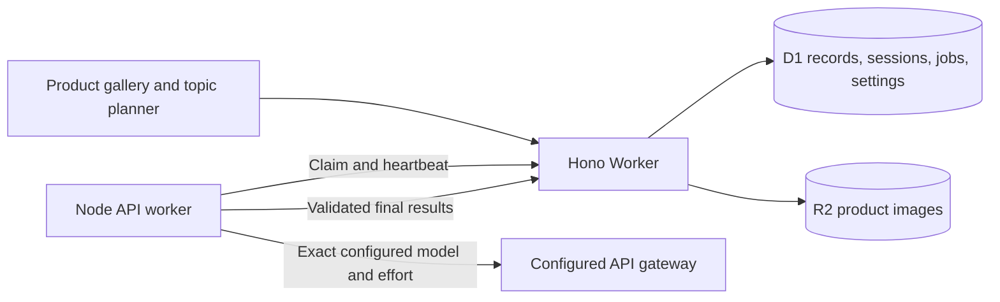

# Architecture and data reference

Fieldnote uses React/TypeScript/Vite for the UI, Hono on Cloudflare Workers for the backend, D1 for structured data, R2 for uploaded product images, and a separate Node 24 API worker for generation.

The worker reads credentials through a runner-authenticated endpoint. The server encrypts the stored API key with AES-GCM using `SETTINGS_ENCRYPTION_KEY` from ignored `.dev.vars`. Public settings expose only a configured flag. Secrets are excluded from job snapshots and workspace exports. No Codex process is spawned.

## Source ownership

- `src/pages`: main library/studio, new-session planners, session detail, catalog, calendar, settings.
- `src/components/ProductGallery.tsx`: image/name selection, search, pagination.
- `src/components/TopicPlanner.tsx`: guidance, generated suggestions, manual/editable topics, batch start.
- `src/components/SessionList.tsx`: independent session status/progress cards.
- `src/components/APISettings.tsx`: redacted settings and asynchronous connectivity test.
- `src/hooks/useWorkspace.tsx`: shared state, persistence actions, polling.
- `src/hooks/useRoute.ts` and `src/lib/routes.ts`: addressable paths and browser history.
- `src/lib/catalog.ts`: pure filtering/pagination.
- `worker/index.ts`: records, image uploads, jobs, protected runner claims/completion.
- `worker/session-routes.ts`: settings, topic/session API, heartbeat, specialized completion.
- `worker/ai-settings.ts`: encrypted credential storage.
- `shared/ai.ts`: Responses/Chat protocol adapter, final-output extraction, sanitized errors.
- `shared/sessions.ts`: topic/report/session contracts.
- `scripts/api-runner.mjs` and `scripts/ai-tasks.mjs`: orchestration and task instructions/JSON schemas.

## Data model

`records` contains products, evidence, and posts. Products store manual facts, affiliate URLs, and optional image IDs. Evidence links a product to a source, assessed claim, limitations, and explicit approval. Posts link product/evidence to platform text, schedule, status, and published URL.

`jobs` stores queued/running/completed/failed work, immutable task snapshots, an ownership token, results/errors, and timestamps. `sessions` links each research/writing topic to one job, product, guidance, progress, sources, report or post IDs, and timestamps. `app_settings` contains encrypted API settings; it is not exported through public workspace state.

Migration 0002 adds sessions/settings without rebuilding or deleting existing records. Completion verifies current job ownership. Duplicate completion cannot create duplicate posts. Citation IDs must belong to actual supplied sources. Editing product content or linked evidence invalidates unpublished approvals; photo-only changes do not.

## Routes

Main routes are `/`, `/products`, `/products/:id`, `/research`, `/studio`, `/calendar`, `/settings`. New planners are `/research/new` and `/studio/new`, optionally with `?product=ID`. Session details are `/research/sessions/:id` and `/studio/sessions/:id`.

The visual shell is shared React navigation with distinct URLs, direct reload support, browser Back/Forward, and real links for native new-tab/copy behavior. Unknown routes and missing products have not-found views. Backend assets and Vite provide the route fallback.

See [API/session guide](api-sessions.md) for endpoint contracts, provider compatibility, research boundaries, and worker behavior. Production deployment still requires verified authentication/authorization; this build intentionally accepts only local hosts and local mode.
